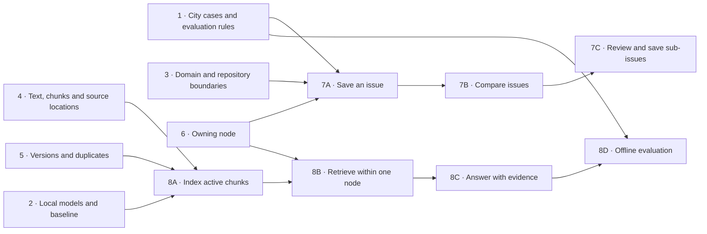

> Note (2026-11-25): `docs/build_plan.md` supersedes the Phase 7 and Phase 8 sections of this roadmap. Kept for history.

# City project implementation roadmap

Start with Phase 7A. It gives the team a small feature to demonstrate without loading a model. Phase 8 can proceed independently once the active document versions and node boundaries are verified.

## Phase 7 · Manage issues

The existing issue model validates IDs and five statuses. Its manager can find direct children and compare two saved issues by shared words. The current repository reads CSV. SQLite already contains the seven City seed issues. Use those rows to check the migration.

| Build in order | Demonstrate completion |
|---|---|
| **7A · Create and persist.** Define the issue metadata and priority against proposal section 12. Add SQLite reads and writes and a CLI to create and show an issue. Validate its owning node. Preserve existing IDs, parents and status spellings through import. | In a test database, load the seven issues, add one at N6, restart the CLI and read back its fields. Re-run migration and verify the new record survives. A failed creation leaves the database intact. |
| **7B · Compare before saving.** Compare a draft with existing issues in its node. Start with the existing shared-word score. Return ordered candidates, scores and matching words for review. Record labeled pairs before selecting a similarity threshold. | A paraphrase about Route 7 crowding is compared with I01. Include an unrelated N6 example and an example from another node. Record missed matches and check ordering on repeat runs. |
| **7C · Generate and review sub-issues.** Let a user request suggestions, edit or reject them, then save accepted children together. Keep parent, sibling position, status and agreed dependency information. Use a fake generator first, then a local model. | Use I01 and its existing children I02–I04. Accept one suggestion in a test copy, reject another and restart. Verify order, parent and status. Test invalid parents, cross-node links and a repeated save. |

**Phase 7 handoff.** Deliver the issue module, sub-issue model, comparison logic and a reproducible CLI example. Record the status rules and the unresolved threshold decision. Executor assignment belongs to Phase 9.

## Phase 8 · Answer from a node’s documents

The baseline runner already ranks chunks by vector similarity. The core already stores chunks, reads active versions by node and formats citations. Reuse those pieces so the production workflow and the experiment can be compared.

| Build in order | Demonstrate completion |
|---|---|
| **8A · Embed and index.** Connect the core embedding port to local Ollama. Start with exact similarity search on the small City corpus. Store vectors with chunk ID, version, model identity and chunking policy. | Restart and reuse the index. Re-ingest the D12 copy without adding duplicate entries. Switch the active D10 version and verify that the old chunks cannot become evidence. Rebuild when model or policy changes. |
| **8B · Retrieve.** Apply owning-node, active-version and requested metadata filters before selecting the best chunks. Return chunk IDs, scores and source locations. | Give a foreign-node chunk the strongest score in a test. It must never enter the evidence list. Exercise Q22, an empty result and a metadata filter that removes the top candidate. |
| **8C · Assemble evidence and answer.** Fit the question, selected passages and source IDs into the local model’s context. Validate citations against the evidence actually supplied. Return `insufficient knowledge` when evidence is missing. | With a fake model, inspect the exact prompt and reject a made-up citation. With the local model, demonstrate the active 135-bus figure, both Route 7 and Route 12 reports where relevant, and a refusal for missing evidence. |
| **8D · Evaluate offline.** Run the 26 City questions on the same corpus and settings as the baseline where possible. Save retrieved IDs, answers, citations, timings and model tags. | Compare retrieval and answer quality separately. For each failure, record whether the source was missed, dropped from the prompt or misread. Check H01, H06 and H09, then run the same workflow with external networking disabled. |

**Phase 8 handoff.** Deliver an offline question-answering command, retrieval and prompt assembly tests, and an evaluation report. Keep measured results separate from supervisor-approved targets.

## Improvements to Phases 1–6

| Phase | Improvement and evidence to keep | When |
|---|---|---|
| **1 · Domain and metrics** | Send the supervisor the open metric targets, glossary choices, registry template and judge threshold. Build a separate unseen question set and keep the original 26 stable. | Start review now. Reserve unseen questions for final evaluation. |
| **2 · Offline baseline** | Record a network-off run, model tags, hardware and `ollama ps`. If testing the alternative Qwen instruct model, label it as a separate run. | Capture the current baseline before comparing Phase 8. |
| **3 · Architecture** | Review A1–A10. Extend the architecture tests to cover the issue and RAG workflows. Exercise the domain with test doubles and SQLite through its repository interface. | Alongside 7A and 8A. |
| **4 · Ingestion** | Verify a real Word file, an image-only D19 PDF and a PDF mixing text and scanned pages. Check extraction page by page and inspect citations. Compare words80 and sections80 with the same model and questions. | Verify input quality before 8D. |
| **5 · Versioning and duplicates** | Review A11–A15. Add labeled near-duplicate and overlap pairs outside the indexed documents, measure M10/M11 and record false matches before tuning. | Verify D10 and D12 before 8B. Broader tuning can run alongside it. |
| **6 · Hierarchy** | Review A16–A20 and unresolved transfer fields with the supervisor. Test a saved hierarchy after restart, including terminal nodes and a rejected invalid move. Use that hierarchy to validate issue ownership and retrieval scope. | Verify node ownership before 7A and 8B. |

## Team of four

You can own all implementation. Give each teammate a review task with a concrete return item.

- **You** build 7A first and demonstrate the restart check. Then follow the two roadmap paths, one milestone per feature commit.
- **Teammate A** labels same-node issue pairs and reviews suggested children for I01. Return the expected matches and reasons for accepting or rejecting each suggestion.
- **Teammate B** traces Q22 and the D10 version question. Return the expected node, eligible sources, and the first step where an observed result differs.
- **Teammate C** checks D19 and the mixed PDF page by page, then witnesses the offline run. Return page-level discrepancies and the settings needed to reproduce them.

For study, use *AI Engineering* chapter 5 while drafting the sub-issue and answer prompts, chapter 6 while implementing retrieval, and chapters 3–4 when interpreting errors. Chapter 8 supports the duplicate and unseen-data work.

The [project proposal](../source/technical-proposal-offline-hierarchical-rag-fa.md) defines the phase deliverables. Use the [baseline report](baseline_report.md) and [hard rules](../metrics/hard_rules.csv) when reviewing evidence.
